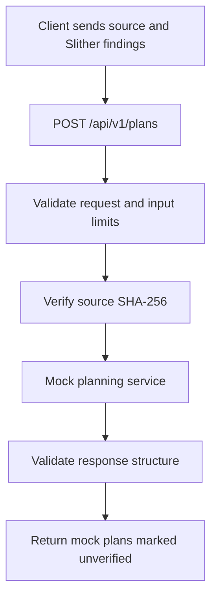
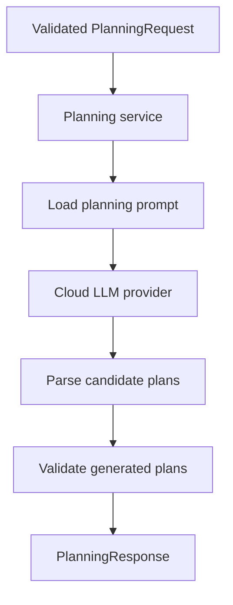

# Exploit Planning Agent Service

FastAPI service that accepts Solidity source code and static-analysis findings and returns structured exploit hypotheses and sandbox test plans.

This service is part of the Autonomous Lending Protocol Auditor project.

> **Current runtime:** The HTTP endpoint uses a mock planner. Provider and LLM planning files are present, but the endpoint is not connected to them. Adding a cloud API key does not enable LLM planning.

Every returned plan is marked `unverified`. A separate sandbox execution service must collect evidence before exploitability can be assessed.

## 1. Implementation Status

| Component | Current status |
|---|---|
| FastAPI application | Implemented |
| Health endpoint | Implemented |
| Request and response schemas | Implemented |
| Source SHA-256 validation | Implemented |
| Configurable input limits | Implemented |
| Mock planning endpoint | Implemented |
| Shared exceptions and API error handling | Implemented |
| Developer 01 API tests | Last reported result: 9 passed |
| Cloud provider interface and adapter | Source files present; integration pending |
| LLM planning workflow | Source present; endpoint integration pending |
| Dedicated generated-plan validator | Pending |
| Complete provider dependency declarations | Pending |
| Docker verification | Pending |
| Live LLM integration verification | Pending |

`status: "completed"` means that the planning request finished. It does not mean that an exploit succeeded or that the contract is secure.

## 2. Service Responsibilities

The service is intended to:

1. Receive Solidity source and static-analysis findings.
2. Validate the request and configured input limits.
3. Verify that the source matches the supplied SHA-256 hash.
4. Generate exploit hypotheses and proposed sandbox tests.
5. Validate generated plans.
6. Return plans linked to the original findings.

The current mock implementation completes steps 1–3 and returns generic placeholder plans.

This service does not:

- Run Slither.
- Compile Solidity.
- Deploy contracts.
- Submit blockchain transactions.
- Execute exploit tests.
- Collect execution evidence.
- Store audit results in a database.

Those responsibilities belong to other project components.

## 3. Request Flow

### Current implementation



### Intended LLM integration



The LLM integration path is not currently connected to the HTTP endpoint.

## 4. Project Structure

```text
exploit-agent-service/
├── app/
│   ├── main.py
│   │
│   ├── api/
│   │   ├── __init__.py
│   │   └── routers/
│   │       ├── __init__.py
│   │       └── planning.py
│   │
│   ├── core/
│   │   ├── __init__.py
│   │   ├── config.py
│   │   └── exceptions.py
│   │
│   ├── schemas/
│   │   ├── __init__.py
│   │   ├── finding.py
│   │   └── planning.py
│   │
│   ├── providers/
│   │   ├── __init__.py
│   │   ├── base.py
│   │   └── openai_provider.py
│   │
│   ├── prompts/
│   │   └── exploit_planning.txt
│   │
│   └── services/
│       ├── mock_planning_service.py
│       └── planning_service.py
│
├── tests/
│   ├── test_planning_api.py
│   ├── test_provider.py
│   ├── test_planning_service.py
│   └── fixtures/
│       ├── contracts/
│       │   └── SimplePool.sol
│       └── responses/
│           └── valid_llm_response.json
│
├── .dockerignore
├── .env.example
├── .gitignore
├── Dockerfile
├── requirements.txt
├── requirements-dev.txt
└── README.md
```

The dedicated `app/services/plan_validator.py` is planned work and is not present in the inspected implementation.

### Main files

| File | Responsibility |
|---|---|
| `app/main.py` | Create the application, validate configuration, register routes |
| `app/api/routers/planning.py` | Planning endpoint and HTTP error handling |
| `app/core/config.py` | Read and validate active input-limit settings |
| `app/core/exceptions.py` | Shared planning exceptions |
| `app/schemas/finding.py` | Incoming static-analysis finding models |
| `app/schemas/planning.py` | Planning request, plan, metadata, and response models |
| `app/services/mock_planning_service.py` | Generate placeholder plans |
| `app/services/planning_service.py` | Coordinate provider, prompt, and validation |
| `app/providers/base.py` | Provider interface and provider-specific exceptions |
| `app/providers/openai_provider.py` | Cloud provider implementation |
| `app/prompts/exploit_planning.txt` | Instructions for generating candidate plans |

## 5. Prerequisites

For local development:

- Windows PowerShell.
- Python 3.14 for the locally verified setup.
- Internet access for dependency installation.
- Postman or Swagger UI for manual API checks.
- Git for version control.

For container execution:

- Docker Desktop using Linux containers.

The local API tests were run with Python **3.14.8**.

The current Dockerfile uses **Python 3.11**. Developer 03 should align or explicitly verify the local and container runtimes before marking Docker integration complete.

The current mock API does not require:

- A cloud API key.
- Slither.
- Solidity compiler.
- A database.
- A running sandbox service.

## 6. Local Setup on Windows

Run commands from the service directory.

### Step 1: Open the service directory

Adjust this path for your checkout:

```powershell
Set-Location "D:\My work\Reseach Project\autonomous-lending-protocol-auditor-backend\services\exploit-agent-service"
```

### Step 2: Create a virtual environment

For a new checkout:

```powershell
py -3.14 -m venv .venv
```

Reuse an existing working virtual environment when continuing development.

The following commands use its Python executable directly, so activation is optional.

### Step 3: Install dependencies

```powershell
.\.venv\Scripts\python.exe -m pip install --upgrade pip
```

```powershell
.\.venv\Scripts\python.exe -m pip install -r requirements-dev.txt
```

```powershell
.\.venv\Scripts\python.exe -m pip check
```

Expected dependency-check output:

```text
No broken requirements found.
```

`requirements-dev.txt` includes:

```text
-r requirements.txt
pytest==9.1.1
httpx2==2.16.0
```

The uvloop dependency must retain its platform marker inside `requirements.txt`:

```text
uvloop==0.23.0; sys_platform != "win32"
```

This is file content, not a PowerShell command. It skips uvloop on Windows.

### Step 4: Create the local environment file

Copy the example only if `.env` does not already exist:

```powershell
if (-not (Test-Path -LiteralPath .env)) {
    Copy-Item -LiteralPath .env.example -Destination .env
}
```

Keep `.env` local. Commit `.env.example` as the shared configuration template.

The mock API does not need a real provider key.

### Step 5: Select the VS Code interpreter

1. Press **Ctrl+Shift+P**.
2. Select **Python: Select Interpreter**.
3. Select **Enter interpreter path** if necessary.
4. Choose this service's `.venv\Scripts\python.exe`.

Use the exploit-agent service environment rather than another service's environment.

### Step 6: Start the application

```powershell
.\.venv\Scripts\python.exe -m uvicorn app.main:app --reload --host 127.0.0.1 --port 8003 --env-file .env
```

Expected startup address:

```text
http://127.0.0.1:8003
```

Stop the application using **Ctrl+C**.

### Step 7: Open the endpoints

| Address | Purpose |
|---|---|
| `http://127.0.0.1:8003/health` | Health endpoint |
| `http://127.0.0.1:8003/docs` | Swagger UI |
| `http://127.0.0.1:8003/openapi.json` | OpenAPI specification |
| `http://127.0.0.1:8003/api/v1/plans` | Planning endpoint; requires POST |

## 7. Configuration

### Active API settings

```dotenv
EPA_MAX_SOURCE_BYTES=200000
EPA_MAX_RESEARCH_CONTEXT_CHARS=20000
```

| Variable | Default | Meaning |
|---|---|---|
| `EPA_MAX_SOURCE_BYTES` | `200000` | Maximum UTF-8 byte length of the submitted source |
| `EPA_MAX_RESEARCH_CONTEXT_CHARS` | `20000` | Maximum string length of optional research context |

Both values must be positive integers.

Configuration is read through `get_settings()` and cached during the server process.

`app/main.py` checks the settings when the application loads. Invalid active settings prevent startup.

The configuration module does not automatically read `.env`. The local startup command loads it through Uvicorn's `--env-file` option. Docker uses its own `--env-file` option.

Restart the server after changing environment values. Avoid conflicting values already exported in the terminal.

These settings limit individual decoded fields. They do not impose an overall HTTP request-body limit.

### Provider settings already present in the template

| Variable | Current template/source value | Intended purpose |
|---|---|---|
| `OPENAI_API_KEY` | Placeholder | Cloud authentication |
| `EPA_MODEL` | `gpt-4o-mini` | Model identifier |
| `EPA_TIMEOUT_SECONDS` | `30` | Provider timeout per attempt |
| `EPA_MAX_RETRIES` | `3` | Current adapter allows up to three total attempts |

The model value above describes the current source; it is not a recommendation or verification of model availability.

The provider currently reads these settings separately. They are not validated by the existing `Settings` dataclass.

Although named `EPA_MAX_RETRIES`, the current adapter passes the value to `stop_after_attempt`. Therefore, `3` currently means three attempts in total.

A per-attempt timeout does not establish an overall HTTP request deadline.

There is no implemented environment setting that switches the route from mock planning to LLM planning.

### Verify the source-size setting

1. Temporarily set:

   ```dotenv
   EPA_MAX_SOURCE_BYTES=10
   ```

2. Restart the server.
3. Send a request containing source longer than ten UTF-8 bytes.
4. Expect HTTP `422` containing:

   ```text
   source_code must not exceed 10 UTF-8 bytes
   ```

5. Restore:

   ```dotenv
   EPA_MAX_SOURCE_BYTES=200000
   ```

6. Restart the server again.

## 8. API Reference

### GET /health

Returns application liveness.

Response: HTTP `200`.

```json
{
  "service": "exploit-agent-service",
  "status": "ok"
}
```

This endpoint does not verify provider credentials, LLM availability, or sandbox readiness.

### POST /api/v1/plans

Content type:

```text
application/json
```

#### Request fields

| Field | Required | Validation |
|---|---|---|
| `audit_id` | Yes | 1–100 characters; cannot be whitespace-only |
| `source_code` | Yes | Nonblank string within the configured UTF-8 byte limit |
| `source_sha256` | Yes | 64 lowercase hexadecimal characters matching the source |
| `findings` | No | List of findings; defaults to `[]` |
| `research_context` | No | String within the configured limit, or `null` |

Unexpected top-level fields are rejected.

#### Finding fields

| Field | Required | Meaning |
|---|---|---|
| `finding_id` | Yes | Original finding identifier |
| `tool_finding_id` | No | Original tool-specific identifier |
| `tool` | No | Defaults to `slither`; other values are rejected |
| `rule_id` | Yes | Detector identifier |
| `description` | Yes | Finding description |
| `severity` | Yes | `High`, `Medium`, `Low`, `Informational`, or `Optimization` |
| `confidence` | Yes | `High`, `Medium`, or `Low` |
| `reference` | No | Reference string |
| `locations` | No | Source locations; defaults to `[]` |

Each location contains:

- `file`
- Optional `start_line`
- Optional `end_line`

Present line numbers must be at least one. The current schema does not check whether the end line follows the start line.

Unlike the top-level request, the finding and location models do not currently reject unknown fields.

#### Response fields

| Field | Meaning |
|---|---|
| `audit_id` | Identifier from the request |
| `status` | `completed` after successful processing |
| `metadata.generation_mode` | `mock` for the current endpoint |
| `metadata.source_sha256` | Submitted and verified source hash |
| `metadata.provider` | `null` for mock responses |
| `metadata.model` | `null` for mock responses |
| `plans` | List of plans |

Each plan contains:

| Field | Meaning |
|---|---|
| `plan_id` | Plan identifier |
| `finding_ids` | References to the associated findings |
| `hypothesis` | Proposed behavior to investigate |
| `preconditions` | Conditions required for the proposed test |
| `test_steps` | Ordered sandbox test instructions |
| `expected_observations` | Observations to look for |
| `evidence_required` | Evidence needed to evaluate the hypothesis |
| `status` | `unverified` |

Schema validation checks structure. It does not establish that a hypothesis is correct or executable.

## 9. Postman Examples

Select:

```text
Method: POST
URL: http://127.0.0.1:8003/api/v1/plans
Body: raw → JSON
```

### Example A: Empty findings

Request:

```json
{
  "audit_id": "planning-check-001",
  "source_code": "pragma solidity 0.8.24; contract Example {}",
  "source_sha256": "40eceac5f321019ad3de3e45fa25dfbe7e19721ff8a49d40d0645b3264891bc1",
  "findings": [],
  "research_context": null
}
```

Expected response: HTTP `200`.

```json
{
  "audit_id": "planning-check-001",
  "status": "completed",
  "metadata": {
    "generation_mode": "mock",
    "source_sha256": "40eceac5f321019ad3de3e45fa25dfbe7e19721ff8a49d40d0645b3264891bc1",
    "provider": null,
    "model": null
  },
  "plans": []
}
```

The plans list is empty because no findings were supplied. This does not mean the source was independently audited.

### Example B: One Slither finding

Keep the source exactly as shown because whitespace affects its hash.

The description below is shortened for readability. Normal integration should preserve the original finding contents.

Request:

```json
{
  "audit_id": "planning-check-002",
  "source_code": "pragma solidity 0.8.24; contract Example { address public owner = msg.sender; function changeOwner(address newOwner) external { require(tx.origin == owner, \"Unauthorized\"); owner = newOwner; } }",
  "source_sha256": "f0c6bc9ddb949e4296bdbd2f4d33d046a00f1725ed59166aad5e323373bbd80c",
  "findings": [
    {
      "finding_id": "63f1b2dd14521f6662a5eb60aedd926a5eab73186688bde6c9e4102cef569a1f",
      "tool": "slither",
      "rule_id": "tx-origin",
      "description": "Example.changeOwner(address) uses tx.origin for authorization.",
      "severity": "Medium",
      "confidence": "Medium",
      "reference": "https://github.com/crytic/slither/wiki/Detector-Documentation#dangerous-usage-of-txorigin",
      "locations": [
        {
          "file": "Contract.sol",
          "start_line": 1,
          "end_line": 1
        }
      ]
    }
  ],
  "research_context": null
}
```

Expected response: HTTP `200`.

```json
{
  "audit_id": "planning-check-002",
  "status": "completed",
  "metadata": {
    "generation_mode": "mock",
    "source_sha256": "f0c6bc9ddb949e4296bdbd2f4d33d046a00f1725ed59166aad5e323373bbd80c",
    "provider": null,
    "model": null
  },
  "plans": [
    {
      "plan_id": "mock-plan-001",
      "finding_ids": [
        "63f1b2dd14521f6662a5eb60aedd926a5eab73186688bde6c9e4102cef569a1f"
      ],
      "hypothesis": "MOCK: Investigate whether the 'tx-origin' finding is exploitable.",
      "preconditions": [
        "The submitted source can be compiled.",
        "A matching isolated test environment is available."
      ],
      "test_steps": [
        "Review the source locations referenced by the finding.",
        "Prepare a sandbox test for the reported behavior.",
        "Record the observed behavior and compare it with the expected authorization or state rules."
      ],
      "expected_observations": [
        "Determine whether the reported behavior can be reproduced under the test conditions."
      ],
      "evidence_required": [
        "Test source and environment configuration.",
        "Execution logs and relevant state changes."
      ],
      "status": "unverified"
    }
  ]
}
```

The mock planner returns one generic plan per supplied finding.

Its IDs, such as `mock-plan-001`, represent positions within the response. They are not globally unique plan identifiers.

### Example C: Incorrect source hash

Change only the first character of Example B's hash from `f` to `0`.

Expected response: HTTP `422`, with an error containing:

```text
source_sha256 does not match source_code
```

### Example D: Missing source

Remove `source_code` from an otherwise valid request.

Expected response: HTTP `422`, with the missing field located at:

```text
body.source_code
```

Do not send a previous response object as the next request body.

## 10. Source Hashing and Static-Analysis Input

The service calculates:

```python
hashlib.sha256(source_code.encode("utf-8")).hexdigest()
```

The hash depends on the exact source string, including:

- Spaces.
- Comments.
- Line endings.
- Trailing newlines.

JSON escapes such as `\n` are decoded before hashing.

To calculate the hash of an existing UTF-8 Solidity file without text-mode newline conversion:

```powershell
.\.venv\Scripts\python.exe -c "import hashlib; from pathlib import Path; source = Path('Contract.sol').read_bytes().decode('utf-8'); print(hashlib.sha256(source.encode('utf-8')).hexdigest())"
```

Build the EPA request using:

| EPA request field | Source |
|---|---|
| `audit_id` | Audit identifier |
| `source_code` | Original source submitted to static analysis |
| `source_sha256` | Static response `metadata.source_sha256` |
| `findings` | Static response `findings` array |
| `research_context` | Optional context string or `null` |

Do not copy the whole static-analysis response into the EPA request. Fields such as `finding_count`, `status`, and the static response's `metadata` object are not EPA request fields.

The hash check confirms consistency between the submitted source and submitted hash. It does not authenticate the caller or prove that the findings came from Slither.

The current EPA does not call the static-analysis service itself.

## 11. Errors and Logging

| Condition | HTTP status | Detail |
|---|---|---|
| Invalid request or exceeded input limit | `422` | Validation errors |
| Source hash mismatch | `422` | Source/hash validation error |
| `PlanningTimeoutError` | `504` | `Planning timed out.` |
| `PlanningProviderError` | `502` | `Planning provider request failed.` |
| `InvalidPlanError` | `502` | `Planning service returned an invalid plan.` |
| Unexpected handler exception | `500` | `Planning failed. Check the service logs for details.` |
| GET request to planning endpoint | `405` | `Method Not Allowed` |

Example service-error response:

```json
{
  "detail": "Planning timed out."
}
```

Request-validation responses use a list under `detail`.

The planning route logs exceptions and audit IDs. Inspect the Uvicorn terminal or Docker logs for diagnostic information.

Internal service exception messages are not returned in the mapped error bodies. Request-validation errors may include the submitted field value.

The mock planner does not enforce a provider timeout. API tests simulate the error conditions.

After LLM integration, the service must raise the shared exceptions for these HTTP mappings to apply.

A response-schema validation failure currently falls through to generic `500` handling unless it has already been translated into `InvalidPlanError`.

## 12. Testing

### Developer 01 API tests

Run:

```powershell
.\.venv\Scripts\python.exe -m pytest tests/test_planning_api.py -v
```

Last reported result:

```text
9 passed in 0.35s
```

Execution time varies by machine.

The suite checks:

1. Empty findings produce empty plans.
2. A finding produces a linked mock plan.
3. Incorrect source hashes return `422`.
4. Missing source returns `422`.
5. Unexpected top-level fields return `422`.
6. Simulated timeouts return `504`.
7. Simulated provider failures return `502`.
8. Simulated invalid plans return `502`.
9. Unexpected failures return `500`.

The four simulated failure cases come from one parametrized test.

The tests also verify that private diagnostic messages do not appear in service-error responses.

`TestClient` runs the application inside the test process:

- Uvicorn does not need to be running.
- No cloud API key is required.
- No cloud API calls are made.

The plain pytest command does not automatically load `.env`. Existing process environment values apply; otherwise defaults are used.

### Provider and planning-service tests

Additional files are present:

```text
tests/test_provider.py
tests/test_planning_service.py
```

These use mocks or dummy providers. Their presence does not establish that they pass in the current checkout.

The provider source imports `openai` and `tenacity`. Provider tests also import `httpx`. These provider/test dependencies are not yet explicitly declared in the inspected requirements files.

Developers 02 and 03 should finalize compatible dependency pins and test imports before verifying the complete suite:

```powershell
.\.venv\Scripts\python.exe -m pytest tests -v
```

Passing the nine API tests does not verify live provider behavior or the complete LLM integration.

## 13. Docker

The current Dockerfile:

- Uses `python:3.11-slim`.
- Installs runtime dependencies.
- Copies the application.
- Runs as a non-root user.
- Exposes port `8003`.
- Starts Uvicorn.

Docker execution is not established by the local API test results. Developer 03 should verify runtime and dependency compatibility.

### Build

From the service directory:

```powershell
docker build -t exploit-agent-service:dev .
```

### Run

Stop any local server already using host port `8003`.

```powershell
docker run --rm --init --env-file .env --name exploit-agent-service -p 127.0.0.1:8003:8003 exploit-agent-service:dev
```

Open:

```text
http://127.0.0.1:8003/health
http://127.0.0.1:8003/docs
```

The container still serves the mock planning endpoint.

### Logs

In another terminal:

```powershell
docker logs -f exploit-agent-service
```

### Stop

```powershell
docker stop exploit-agent-service
```

`--rm` removes the stopped container, but keeps the image.

Rebuild after application, dependency, or Dockerfile changes. Recreate the container after environment changes.

The current image does not install development requirements or include the tests directory.

Developer 03 should extend `.dockerignore` to exclude local environment files, Git metadata, and test caches from the build context.

## 14. Developer Responsibilities

### Developer 01: API and data contracts

Owns:

- FastAPI application and health endpoint.
- Planning route.
- Request and response schemas.
- Incoming finding schemas.
- Input-limit configuration.
- Source hash validation.
- Shared exceptions.
- HTTP error responses.
- Mock-based API tests.

The initial Developer 01 milestone has nine passing API tests and manual verification of configurable source limits.

After integration, Developer 01 should verify the endpoint against the real planning service.

### Developer 02: LLM planning

Owns:

- Provider interface and implementation.
- Planning prompt.
- Planning workflow.
- Provider configuration and dependency declarations.
- Provider timeout and retry behavior.
- Provider/service unit tests.
- Translation of provider-specific exceptions.

The service boundary should accept `PlanningRequest` and return `PlanningResponse`.

Real responses must report:

- `generation_mode="llm"`.
- Actual provider name.
- Actual model identifier.
- Plans marked `unverified`.

The current adapter uses Chat Completions JSON-object mode followed by Pydantic validation. It does not currently use a strict remote JSON-schema response format.

The prompt treats source, findings, and research context as untrusted data. Output validation is still required.

### Developer 03: Validation and delivery

Owns:

- Dedicated generated-plan validator.
- Finding-reference and output-consistency checks.
- Rejection of unsupported execution-success claims.
- Validator tests.
- Integration tests.
- Docker verification.
- Final onboarding documentation.

Validation failures should raise `InvalidPlanError`.

Structural or semantic validation does not prove exploitability. A sandbox must provide execution evidence.

## 15. Integration Requirements

The intended boundary is:

```text
PlanningRequest → Planning service → PlanningResponse
```

The existing real service exposes:

```text
generate_exploit_plans(request)
PlanningService.create_plan(request)
```

The route currently calls:

```text
create_mock_plans(request)
```

Before connecting the real implementation:

1. Finalize and install provider dependency pins.
2. Validate provider credentials, model, timeout, and attempt settings.
3. Connect the dedicated plan validator.
4. Translate provider errors into shared service exceptions.
5. Connect the route to the agreed planning entry point.
6. Coordinate any asynchronous interface change.
7. Update API tests to inject a planner or provider.
8. Verify the full automated suite and Docker.
9. Perform a deliberate live smoke test when integration is ready.

Automated tests should continue using injected mocks rather than live API calls.

### Exception translation

The provider exceptions and API exceptions are currently separate classes:

| Provider/workflow exception | Shared API exception |
|---|---|
| `ProviderTimeoutError` | `PlanningTimeoutError` |
| `ProviderError` | `PlanningProviderError` |
| `ProviderOutputError` | `InvalidPlanError` |
| Semantic plan-validation failure | `InvalidPlanError` |

Translate specific timeout/output exceptions before the provider base exception.

Simply swapping the route's planner import does not complete this mapping. Unconverted exceptions will reach generic `500` handling.

The fallback validator currently raises `ValueError` for unknown finding IDs. Finalize its contract and translate failures rather than relying on the fallback as the completed validator.

## 16. Troubleshooting

| Problem | Action |
|---|---|
| Pydantic import cannot be resolved | Select this service's virtual environment in VS Code and install development requirements |
| `No module named app...` | Run from the service root and verify the module paths |
| Missing `openai`, `tenacity`, or `httpx` | Finalize provider/test dependency declarations with Developer 02 |
| Planning endpoint returns `405` | Use POST; browser address-bar navigation sends GET |
| Request returns missing `source_code` | Send the request object rather than a previous response |
| Source hash mismatch | Hash the exact submitted source |
| Source exceeds ten bytes | Restore the normal source limit and restart |
| `.env` changes do not apply | Use `--env-file .env`, check exported values, and restart |
| Startup rejects configuration | Active limits must be positive integers |
| API still returns mock metadata | Expected until the route is connected to the real planner |
| Port `8003` is unavailable | Stop the other process/container or choose a different host port |
| `500` after provider integration | Inspect logs, dependencies, configuration, exception translation, and validator wiring |
| uvloop fails on Windows | Keep its platform marker in `requirements.txt` |

## 17. Git and Local Files

Keep these files in version control:

- Application source.
- Tests and fixtures.
- Dependency files.
- Docker configuration.
- `.env.example`.
- `.gitignore`.
- README.

Keep local environment files, virtual environments, caches, and logs ignored.

Check ignore behavior:

```powershell
git check-ignore .env .venv/ .pytest_cache/
```

If `.env` was already tracked, remove it from the Git index while keeping the local file:

```powershell
git rm --cached -- .env
```

## 18. Current Limitations

- The HTTP endpoint returns generic mock plans.
- It does not independently analyze Solidity semantics.
- It does not compile source or execute Slither.
- Source hashing does not authenticate finding provenance.
- Dedicated semantic plan validation remains pending.
- Live provider integration remains pending.
- No sandbox execution or execution-feedback loop is implemented here.
- Research context is supplied as a string; this service does not retrieve RAG documents itself.
- No database persistence, background queue, authentication, or rate limiting is implemented.
- There is no overall request-body or findings-count limit.
- Mock plan identifiers are not globally unique.
- Passing mock API tests does not demonstrate LLM accuracy, Docker compatibility, or exploit reproducibility.

Update this README's status, configuration, examples, and test results when the real planning service and validator are integrated.
