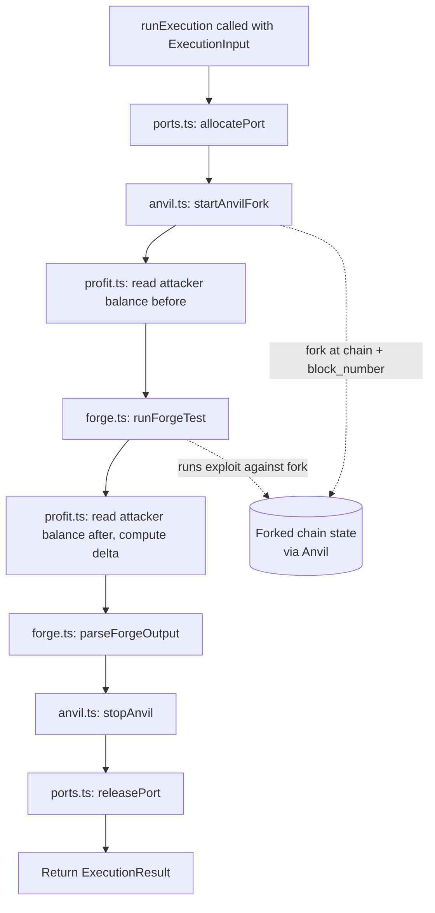

# Sandboxed Execution Service

Part of the smart contract audit platform. This service answers one question: **does a given exploit actually work, and what happens when it runs?**

Last updated: 28 Oct 2026.

## 1. What this service does

Given a target chain, a block number, and a piece of Solidity exploit code, the service:

1. **Forks the real chain at that exact block**, using Anvil (part of Foundry), so the exploit runs against authentic historical state.
2. **Runs the exploit against that fork**, using Forge, and captures the full execution trace.
3. **Reports what happened** — did it succeed, did it revert, how much native currency (ETH/BNB) moved, how much gas it used.

This service does not write exploit code and does not decide whether a vulnerability is worth pursuing. It only answers "if you run this code against this exact historical state, what happens?" Another service (EPA) generates the exploit code; this service validates it with real execution.

This is the **Concrete Execution Environment** piece of the A1 paper's design (Gervais & Zhou, arXiv:2507.05558) — the "run it and tell me what happened" tool, not the agent that decides what to try.

## 2. Status

| Part | Status |
| --- | --- |
| `types.ts` — shared contract (`ExecutionInput` / `ExecutionResult`) | Done |
| `ports.ts` — port allocation for concurrent runs | Done |
| `anvil.ts` — fork startup/teardown | Done |
| `forge.ts` — run exploit, parse pass/fail | Done, tested against real Forge output |
| `profit.ts` — native-currency profit measurement | Done |
| `execute.ts` — orchestration (`runExecution`) | Done, tested end-to-end |
| Express/API layer, database | Separate branch (Person B), not covered here |
| Docker | Not yet built — see section 8 |

## 3. Inputs and outputs

This is the shared contract (`src/runtime/types.ts`) that the rest of the system calls.

### Input

```ts
interface ExecutionInput {
  audit_id: string;
  chain: string;              // "ethereum" | "bsc" for now
  block_number: number;
  exploit_code: string;       // complete Foundry test file (see section 6)
  mode: "baseline" | "exploit_attempt";
}
```

### Output

```ts
interface ExecutionResult {
  status: "success" | "failed" | "revert";
  revert_reason: string | null;
  profit_native: number;      // ETH or BNB delta, attacker address only
  gas_used: number;           // summed across all calls in the trace
  execution_trace: string;    // raw forge output
  duration_ms: number;
}
```

`status: "revert"` covers any `[FAIL: ...]` result from Forge — a reverted call, a failed assertion, a reverted cheatcode expectation all land here, since Forge's own output doesn't distinguish between them at the text level. `status: "failed"` is reserved for cases where Forge produced neither `[PASS]` nor `[FAIL]` at all — a compile error or a crash before the test ran.

## 4. How the service works



Every step after `startAnvilFork` runs inside a `try`, with Anvil teardown and port release in a `finally` — so a crash or a Forge timeout still cleans up the fork and frees the port rather than leaking either.

### Isolation

Every run gets its own Anvil process on its own port (`ports.ts` tracks ports 9000–9999 in memory). Two concurrent audits never share chain state — each gets a fresh fork. This is process-level isolation, not container-level; Docker-per-run is the long-term correct answer but wasn't in scope for this build (see section 8).

### Timeouts

Both external processes this service spawns have hard timeouts, because the exploit code running inside them is LLM-generated and not reviewed before it runs:

- Anvil startup: 30 seconds (fork never came up — bad RPC URL, rate limiting, network issue)
- Forge test run: 2 minutes (exploit code hangs — infinite loop, stuck call)

Both timeouts kill the process and reject with a clear error rather than hanging indefinitely.

## 5. Profit measurement — what it does and doesn't capture

`profit.ts` reads the native-currency balance (ETH/BNB) of a fixed attacker address — Anvil's default first dev account, `0xf39fd6e51aad88f6f4ce6ab8827279cfffb92266`, funded automatically on every fork regardless of chain — before and after the exploit runs, and reports the delta.

This is a deliberate simplification of the A1 paper's approach. A1 provisions the attacker with large reserves across several tokens, then sweeps every token gain into native currency through DEX routing (DexUtils) before reporting profit, so its numbers are a true "total value extracted" figure. This service does not do that — **if an exploit's gains are left in an ERC-20 token and never touch native currency, `profit_native` reports `0` even though real value was extracted.** This is a known blind spot, not a bug. A report built on this number should treat `0` as "no native-currency movement detected," not "nothing happened."

## 6. What exploit code is expected to look like

`exploit_code` is assumed to be a complete Foundry test file:

```solidity
pragma solidity ^0.8.19;
import "forge-std/Test.sol";

contract ExploitTest is Test {
    function setUp() public {
        // fund the attacker here if needed — this service does not
        // pre-fund any account, unlike A1's Initial State Normalization step
    }
    function testExploit() public {
        // the attack
    }
}
```

Two things whoever generates this code needs to know, since this service doesn't provide them automatically:

- **Funding is the exploit code's own job.** This service does not pre-fund any token or native-currency balance before a run. If an exploit needs working capital (gas, seed tokens, flashloan setup), `setUp()` must acquire it itself via Forge cheatcodes (`vm.deal`, `deal(...)`).
- **The attacker address is Anvil's default account 0** (`0xf39fd6e51aad88f6f4ce6ab8827279cfffb92266`) — exploit code should act as or control this address, since that's the address `profit.ts` measures.

This assumption (complete Test-file, not a bare contract) is unconfirmed with whoever owns EPA — see section 7.

## 7. Known integration gaps (not yet resolved with EPA)

This service's input contract needs more than EPA alone can currently supply. Flagged here rather than silently worked around:

1. **`exploit_code` doesn't exist in EPA's current response schema.** EPA's `PlanningResponse` returns prose (`hypothesis`, `test_steps`, etc.), not Solidity. Per the A1 paper's design, the fix is: EPA's prompt should instruct the LLM to also emit a fenced ` ```solidity ` code block, which EPA's backend regex-extracts and returns as a new `exploit_code` field.
2. **`chain` and `block_number` aren't in EPA's schema at all** — `PlanningRequest`/`PlanningResponse` only carry `audit_id`, `source_code`, `source_sha256`, `findings`, `research_context`. Whoever assembles the final call to `runExecution` needs to carry `chain`/`block_number` through from the original audit submission, separately from EPA's output.
3. **The attacker address and self-funding convention** (section 6) need to be known by whoever writes EPA's prompt, so generated exploit code actually works against this service rather than failing for lack of funds.
4. **Whether `research_context` (presumably RAG-LLM's output) actually reaches EPA's prompt** is unconfirmed — the field exists in EPA's schema but the README doesn't show it being used yet.

## 8. Local setup

```bash
# 1. Install Foundry (gives you the `anvil` and `forge` binaries)
curl -L https://foundry.paradigm.xyz | bash
foundryup
anvil --version   # confirm it worked
forge --version

# 2. Install dependencies
npm install

# 3. Set up environment variables
cp .env.example .env
# fill in ETH_RPC_URL and BSC_RPC_URL — Alchemy or Infura free tier both work

# 4. Build the Foundry template project (one-time)
mkdir foundry-template
cd foundry-template
forge init --no-git --no-commit .
rm -f src/Counter.sol test/Counter.t.sol script/Counter.s.sol
cd ..

# 5. Run the manual integration test
npx tsx src/runtime/manual-test.ts
```

Expected output ends with a JSON `ExecutionResult` — `status: "success"`, `revert_reason: null` for the default placeholder test.

### Required environment variables

| Variable | Meaning |
| --- | --- |
| `ETH_RPC_URL` | Archive/fork-capable RPC endpoint for Ethereum |
| `BSC_RPC_URL` | Archive/fork-capable RPC endpoint for BSC |

Confirm your RPC provider's free tier supports forking at arbitrary historical blocks, not just recent ones — some free tiers restrict how far back you can query.

### Docker

Not yet built for this service. Foundry needs to be installed inside the image (not just Node), and running as a non-root user conflicts with Foundry's default install location (`/root/.foundry`) — this needs resolving before a working Dockerfile exists. Flagged as follow-up work, not done here.

## 9. Files in `src/runtime`

| File | Job |
| --- | --- |
| `types.ts` | `ExecutionInput` / `ExecutionResult` — the frozen contract with the API layer |
| `ports.ts` | Tracks free local ports (9000–9999) so concurrent runs don't collide |
| `anvil.ts` | Spawns/tears down a forked-chain Anvil process, waits for it to be ready |
| `forge.ts` | Writes exploit code into a temp Foundry project, runs `forge test`, parses pass/fail |
| `profit.ts` | Reads the attacker's native-currency balance before/after, returns the delta |
| `execute.ts` | Orchestrates all of the above behind `runExecution` |
| `manual-test.ts` | Not part of the real build — standalone script for local verification, calls `runExecution` directly with a hardcoded input |

## 10. Limits to know

- **Native-currency profit only** — see section 5. Token gains that never convert to ETH/BNB are invisible to `profit_native`.
- **No pre-funding** — exploit code must fund its own attacker address; this service provisions nothing.
- **Process-level isolation, not container-level** — real, but less strict than Docker-per-run. Documented simplification, not an oversight.
- **`revert` vs `failed` is coarse** — based on what Forge's own output actually distinguishes (see section 3), not a finer-grained classification.
- **Forge timeout (2 min) and Anvil startup timeout (30s) are both guesses**, not measured against real complex exploit runtimes yet. Revisit once there's a sample of real (non-trivial) exploit executions to time.
- **`SIGTERM`, not `SIGKILL`, on teardown** — `stopAnvil` and the Forge timeout's kill both send a polite termination signal. A process that ignores it could linger; not yet handled with a forced-kill fallback.
